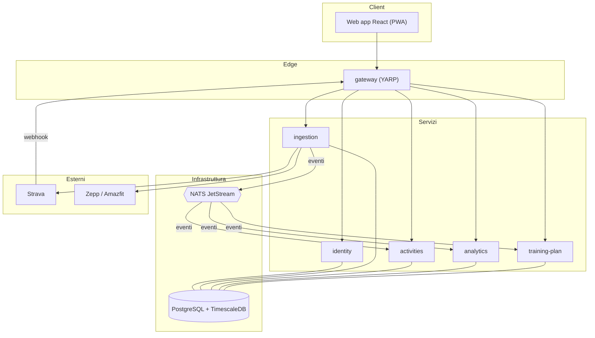
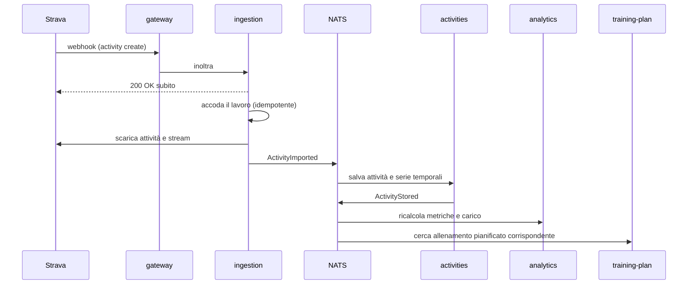

# 00 · Panoramica

## Contesto

Un atleta pratica corsa, bici e nuoto e registra gli allenamenti su dispositivi e servizi diversi. Strava li raccoglie ma offre analisi e programmazione limitate. L'applicazione:

1. raccoglie le attività da più fonti in un modello comune;
2. calcola metriche di carico, forma e stime fisiologiche;
3. permette di pianificare gli allenamenti e di confrontarli con quanto svolto.

Utenti: atleti amatori ed evoluti/élite. All'inizio un solo sviluppatore, che è anche il primo utente.

## Obiettivi di qualità

In ordine di importanza:

1. **Correttezza dei dati:** un'attività non si perde né si duplica, anche con webhook ripetuti o fuori ordine.
2. **Apprendimento:** l'architettura deve esercitare pratiche reali di sistemi distribuiti (eventi, idempotenza, osservabilità).
3. **Reattività:** interfaccia veloce su mobile, grafici fluidi anche con attività lunghe.
4. **Manutenibilità da una sola persona:** confini chiari, poca magia, strumenti di sviluppo locale semplici.
5. **Privacy:** dati sanitari e di posizione protetti e cancellabili.
6. **Portabilità:** nessuna dipendenza da un cloud o da un solo runtime di contenitori.

## Vincoli

- Backend in **C#**.
- Architettura a **microservizi**.
- Contenitori con **Docker o Podman**.
- Frontend web utilizzabile su desktop e telefono.
- Strava è la fonte principale; le sue API hanno limiti di richieste e regole d'uso (da verificare, vedi [07-integrations.md](07-integrations.md)).

## Vista d'insieme

## Flusso principale: nuova attività da Strava

Il webhook risponde subito; il resto è asincrono. Strava richiede una risposta rapida e riprova in caso di errore, quindi l'elaborazione deve essere idempotente.

## Principi guida

1. **Ogni servizio possiede i propri dati.** Nessun accesso diretto al database di un altro servizio.
2. **Eventi per i fatti, API per le domande.** Cosa è successo si pubblica; per leggere dati altrui si usa un'API o una copia locale mantenuta via eventi.
3. **Idempotenza ovunque.** Ogni consumatore tollera lo stesso messaggio più volte.
4. **Il modello comune è nostro.** I formati di Strava, Zepp o FIT vengono tradotti al confine (`ingestion`) e non penetrano negli altri servizi.
5. **Semplice prima, scalabile poi.** Si parte da un'istanza per servizio; la scalabilità orizzontale è una conseguenza, non un obiettivo iniziale.
6. **Ogni decisione ha un ADR.** Se non è scritta, non è decisa.
