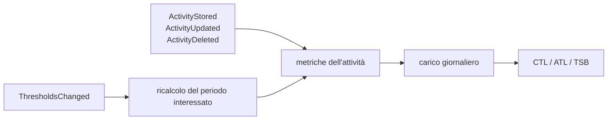

# 08 · Analisi e metriche

Descrive **cosa** si calcola e con quali ipotesi. Le formule esatte si fissano con i primi test; l'obiettivo è che ogni numero mostrato sia **spiegabile** all'utente (da dove viene, con quali dati).

> Le stime sono indicative e non sostituiscono test di laboratorio né consigli medici. L'interfaccia deve dirlo e mostrare la confidenza dove possibile.

## Profilo fisiologico dell'atleta

Dati con **storico** (ogni valore vale da una data):

- Frequenza cardiaca massima e a riposo
- FTP (potenza di soglia in bici)
- Soglia di ritmo in corsa
- Soglia di ritmo in nuoto (CSS, *critical swim speed*)
- Peso, età, sesso (per le stime energetiche)

Fonte: inserimento manuale o stima automatica proposta dal sistema e confermata dall'utente. Un cambio pubblica `ThresholdsChanged`.

## Metriche per attività

| Metrica | Sport | Note |
|---|---|---|
| Tempo nelle zone (FC, potenza, ritmo) | Tutti | Zone derivate dalle soglie |
| Carico di allenamento (TSS e varianti) | Tutti | Bici con potenza; corsa e nuoto con ritmo o FC quando manca la potenza |
| Potenza normalizzata, IF | Bici | Richiede dati di potenza |
| Ritmo corretto per pendenza | Corsa | **[Ipotesi]** facoltativo |
| SWOLF, ritmo per 100 m | Nuoto | Richiede dati delle vasche |
| Record personali per distanza/durata | Corsa, bici, nuoto | Curve di miglior sforzo (*power/pace curve*) |

Quando mancano i dati per calcolare una metrica, si **omette** e lo si dice, invece di stimare in silenzio.

## Metriche per atleta

- **CTL / ATL / TSB:** carico cronico (forma a lungo termine), acuto (fatica recente) e bilancio (freschezza), ottenuti da medie mobili esponenziali del carico giornaliero. Costanti tipiche 42 e 7 giorni, configurabili.
- **VO2max:** andamento stimato (dal PoC). Il metodo va scelto e documentato (da ritmo e FC in corsa, da potenza in bici).
- **FTP stimata:** dal miglior sforzo di durata adeguata, con fattore di correzione documentato (dal PoC).
- **TDEE:** dispendio energetico giornaliero (dal PoC): metabolismo basale + energia delle attività; formula e fonte da documentare.
- **Riepiloghi** settimanali e mensili: volume, tempo, dislivello, carico per sport.

## Quando si ricalcola

- Una nuova attività aggiorna le sue metriche e il carico di quel giorno e dei giorni seguenti.
- Un cambio di soglie richiede di **ricalcolare lo storico** interessato: deve essere un'operazione in background, interrompibile e idempotente.
- I risultati sono versionati con la versione dell'algoritmo, così una formula migliorata si può rieseguire.

## Principi

1. **Funzioni pure** per le formule: ingressi → uscite, senza accesso a database. Facilissime da testare con casi noti.
2. **Test con dati di riferimento:** attività di esempio con risultati attesi verificati a mano.
3. **Trasparenza:** ogni metrica espone formula, dati usati e limiti.
4. **Fonti e riferimenti** delle formule scritti nel codice e in questo documento man mano che si scelgono.

## Da definire

- Metodo preciso per ciascuna stima (VO2max, FTP, TDEE) e fonti bibliografiche.
- Gestione del carico per corsa e nuoto senza potenza.
- Trattamento dei dati mancanti o anomali (pause, errori del sensore).
- Visualizzazioni: quali grafici, con quali confronti.
