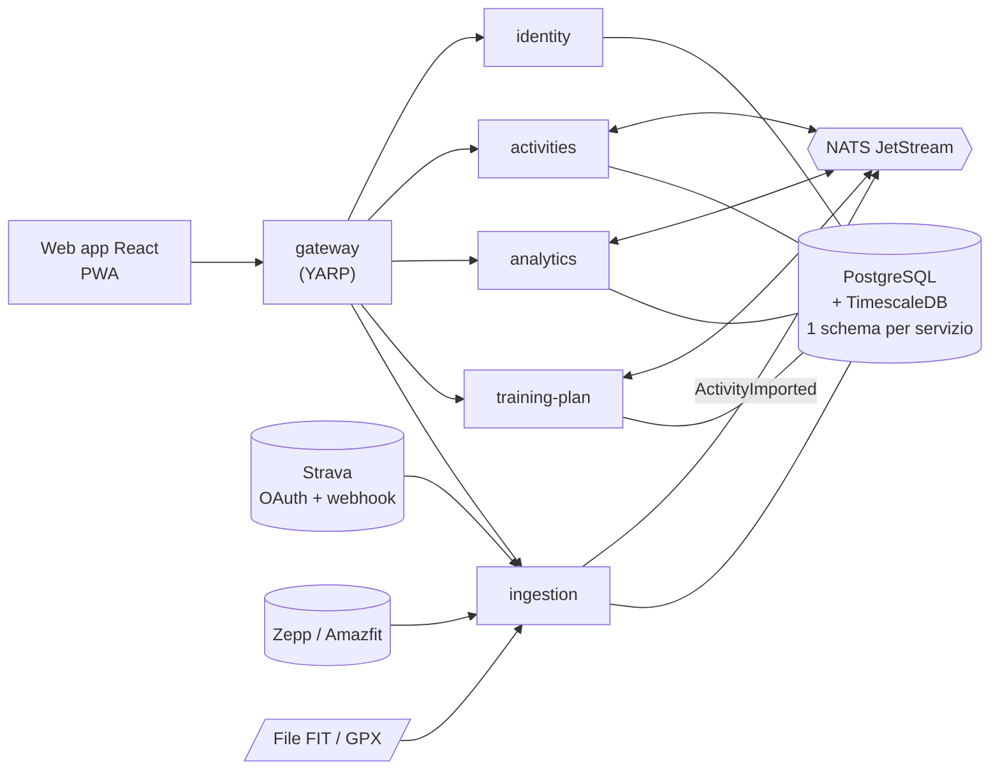

# TriMetric *(nome provvisorio)*

Piattaforma web (desktop e mobile) che unisce gli allenamenti di **corsa, bici e nuoto** in un unico posto. Affianca le statistiche di Strava e aiuta ad analizzare, programmare e pianificare l'allenamento, sia per l'atleta amatore sia per quello evoluto o élite.

> **Stato:** scheletro del sistema funzionante. Dal web si carica un file **GPX o FIT**; `ingestion` lo traduce nel modello comune e pubblica `ActivityImported` su NATS; `activities` lo salva (attività, giri e stream in TimescaleDB) e lo espone via API; il `gateway` (YARP) instrada le richieste; il web mostra elenco e dettaglio delle attività. Con un'**identità di sviluppo fissa**: non c'è ancora login. **Non esistono** ancora: collegamento Strava e Zepp, `identity`, `analytics`, `training-plan`, grafici e mappe, PWA, calendario e programmazione; i servizi nel contenitore e la pipeline di integrazione continua sono previsti. Il resto del documento descrive il disegno previsto, salvo dove indicato. Come avviarlo: [Avvio](#avvio).
> Il punto di partenza funzionale è il PoC [LucaFerro01/TriMetric](https://github.com/LucaFerro01/TriMetric); lo stack viene invece riprogettato da zero.

---

## Obiettivi

- Raccogliere in un'unica base dati le attività provenienti da più fonti (Strava, Zepp/Amazfit, file FIT/GPX; Bryton passa da Strava).
- Offrire analisi che vanno oltre quelle di Strava: carico, forma fisica, stime fisiologiche, confronto tra pianificato e svolto.
- Permettere di **programmare** gli allenamenti (piani, template, allenamenti a step) e di seguirne l'esecuzione.
- Funzionare bene su desktop e su telefono (PWA installabile).
- Essere un terreno di apprendimento per **C#/.NET** e per un'**architettura a microservizi** reale.

### Non obiettivi (per ora)

- Sostituire Strava come rete sociale (feed, segmenti, kudos).
- Consulenza medica o consigli personalizzati di tipo clinico.
- Supporto multi-squadra o multi-allenatore (resta una possibile evoluzione, vedi [Roadmap](#roadmap)).

---

## Funzionalità

Derivate dal PoC e organizzate per area. La priorità è indicativa.

### 1. Sincronizzazione e import

| Funzione | Note dal PoC | Priorità |
|---|---|---|
| Login e collegamento con **Strava** (OAuth 2.0) | Flusso `/auth/strava` e callback | MVP |
| Ingestione attività in tempo reale via **webhook Strava** | Webhook, coda e worker asincrono | MVP |
| Import manuale di file **FIT** e **GPX** | Parsing lato server | MVP |
| Sincronizzazione **Zepp/Amazfit** | API non ufficiale, può cambiare senza preavviso | Dopo MVP |
| **Bryton** | Arriva indirettamente tramite Strava | MVP (gratis con Strava) |
| Altri produttori (Garmin, Coros, Wahoo, Polar) | Non presenti nel PoC | Idea |

### 2. Attività

- Elenco con filtri per sport, periodo e distanza.
- Dettaglio: mappa del percorso, grafici di passo/velocità, frequenza cardiaca, potenza, cadenza, altimetria, giri (lap).
- Tre sport trattati come cittadini di prima classe, con metriche specifiche:
  - **Corsa:** passo, ritmo, dislivello, cadenza.
  - **Bici:** potenza, velocità, cadenza, dislivello.
  - **Nuoto:** vasche, ritmo per 100 m, SWOLF.

### 3. Analisi e statistiche

Dal PoC:

- **VO2max**: andamento nel tempo.
- **FTP**: stima della soglia di potenza in bici.
- **TDEE**: dispendio energetico giornaliero.
- **Riepiloghi** settimanali e mensili.

Da aggiungere (da definire nel dettaglio, vedi [`ARCHITECTURE/08-analytics.md`](ARCHITECTURE/08-analytics.md)):

- Carico di allenamento (TSS e varianti per sport) e curva **CTL/ATL/TSB** (condizione, fatica, forma).
- Zone di frequenza cardiaca, potenza e ritmo, configurabili per atleta.
- Record personali e confronto tra periodi.
- Stato di forma e tendenze, con spiegazione di come è calcolato ogni numero.

### 4. Programmazione e pianificazione

Dal PoC (pagina *Scheduling*, tabelle `scheduled_workouts`, step e libreria template):

- **Libreria di template** di allenamenti riutilizzabili.
- **Allenamenti a step** (riscaldamento, ripetute, recupero, defaticamento) con target per ritmo, potenza o frequenza cardiaca.
- **Calendario** di allenamenti pianificati.
- **Matching** automatico tra allenamento pianificato e attività effettivamente svolta, con indicatore di aderenza.

Da aggiungere:

- Piani su più settimane con periodizzazione (base, costruzione, picco, scarico) e obiettivo di gara.
- Esportazione degli allenamenti verso orologi e ciclocomputer (formato FIT workout), se le integrazioni lo permettono.

### 5. Profilo e impostazioni

- Dati dell'atleta (peso, età, FC massima, FTP, soglie) con storico.
- Gestione dei collegamenti ai servizi esterni e delle autorizzazioni.
- Esportazione e cancellazione dei propri dati.

### Pagine previste nel frontend

Dashboard · Attività · Dettaglio attività · Analisi · Calendario e programmazione · Libreria allenamenti · Upload · Profilo · Collegamenti

Oggi esistono solo **Attività** (elenco), **Dettaglio attività** e **Upload** (pagina «Carica»); le altre sono previste.

---

## Architettura in breve

Dettagli e motivazioni in [`ARCHITECTURE/`](ARCHITECTURE/README.md). Il diagramma e la tabella dei servizi mostrano il **disegno completo**: oggi sono implementati `gateway` (solo le rotte verso `ingestion` e `activities`), `ingestion` (solo file GPX/FIT) e `activities`; `identity`, `analytics` e `training-plan` hanno solo la cartella con il README.



| Servizio | Responsabilità |
|---|---|
| `gateway` | Punto d'ingresso unico, routing, autenticazione dei token, rate limiting (YARP). |
| `identity` | Utenti, sessioni, token, collegamenti OAuth con i servizi esterni. |
| `ingestion` | Connettori Strava/Zepp, webhook, parsing FIT/GPX, normalizzazione in un modello comune. |
| `activities` | Archivio delle attività e delle serie temporali (stream) di ciascuna. |
| `analytics` | Calcolo di metriche, carico, zone, stime (VO2max, FTP, TDEE) e riepiloghi. |
| `training-plan` | Template, allenamenti a step, calendario, piani e matching pianificato/svolto. |

### Stack

| Ambito | Scelta | Perché |
|---|---|---|
| Backend | **C# / .NET**, ASP.NET Core minimal API | Obiettivo di apprendimento, ottime prestazioni, ecosistema maturo |
| Gateway | **YARP** | Reverse proxy di Microsoft, si integra in .NET |
| Messaggistica | **NATS JetStream** | Leggero, semplice da gestire in locale, persistenza e riconsegna dei messaggi. Confermato dallo scheletro ([ADR 0003](ARCHITECTURE/adr/0003-messaggistica-nats.md)) |
| Database | **PostgreSQL + TimescaleDB** | Dati relazionali e serie temporali in un solo motore. Confermato ([ADR 0004](ARCHITECTURE/adr/0004-database-postgres-timescale.md)) |
| Accesso ai dati | **EF Core** per tabelle e migrazioni, `COPY` binario (Npgsql) per gli stream | Deciso con lo scheletro, vedi [`03-data.md`](ARCHITECTURE/03-data.md); Dapper non usato |
| Frontend | **React + TypeScript + Vite** (PWA prevista, non presente) | Più componenti disponibili, ottimo supporto degli strumenti di IA |
| UI e grafici | Tailwind CSS con componenti scritti a mano (in uso); shadcn/ui, Recharts (o visx), MapLibre previsti | Grafici e mappe da confermare in fase di prototipo |
| Dati lato client | TanStack Query + TanStack Router | Cache e routing tipizzati |
| Contenitori | **Docker o Podman** (`compose.yaml` neutro) per l'infrastruttura; i servizi non sono ancora in contenitori | Nessuna funzione specifica di un solo runtime; provato solo con Docker |
| Sviluppo locale | **Script `scripts/dev.ps1` e `scripts/dev.sh`** (compose per PostgreSQL e NATS, poi servizi e web); .NET Aspire resta un'ipotesi | Un solo comando, nessuna dipendenza da Aspire ([`05-infrastructure.md`](ARCHITECTURE/05-infrastructure.md)) |
| Osservabilità | **OpenTelemetry** (esportazione OTLP solo se configurata) e log JSON con `correlationId` | Log, metriche e tracce distribuite |

I punti ancora aperti (ad esempio micro-frontend sì/no, autenticazione, libreria di grafici e mappe, limiti noti dello scheletro) sono elencati in [`ARCHITECTURE/README.md`](ARCHITECTURE/README.md#decisioni-aperte).

---

## Struttura del repository

```text
.
├── README.md
├── TriMetric.slnx           Solution .NET (servizi, progetti condivisi, test)
├── .config/dotnet-tools.json  Strumenti .NET locali (dotnet-ef per le migrazioni)
├── global.json              SDK .NET fissato (11.0.100, target net10.0)
├── Directory.Build.props    Impostazioni comuni di build (warning come errori)
├── Directory.Packages.props Versioni dei pacchetti NuGet, centralizzate
├── ARCHITECTURE/            Scelte architetturali e decisioni (ADR)
│   ├── README.md            Indice e decisioni aperte
│   ├── 00-overview.md … 08-analytics.md
│   └── adr/                 Un file per decisione
├── docs/
│   └── getting-started.md   Guida iniziale: avvio, prova a mano, test, problemi comuni
├── scripts/
│   ├── dev.ps1              Avvio locale su Windows (infrastruttura, servizi, web)
│   └── dev.sh               Avvio locale su Linux, macOS, Git Bash
├── src/
│   ├── services/            Microservizi C# (un progetto e una cartella di test ciascuno)
│   │   ├── gateway/         Implementato
│   │   ├── ingestion/       Implementato (file GPX/FIT)
│   │   ├── activities/      Implementato
│   │   ├── identity/        Previsto (solo README)
│   │   ├── analytics/       Previsto (solo README)
│   │   └── training-plan/   Previsto (solo README)
│   ├── shared/
│   │   ├── contracts/       Eventi e contratti condivisi (solo definizioni)
│   │   ├── ServiceDefaults/ Salute, logging, telemetria, identità di sviluppo
│   │   └── Messaging/       Client NATS, outbox, inbox, consumatore con DLQ (solo infrastruttura)
│   └── web/                 Frontend React (Vite, TypeScript); PWA prevista
├── tests/
│   ├── TriMetric.TestInfrastructure/        Fixture Testcontainers (TimescaleDB, NATS)
│   ├── TriMetric.TestInfrastructure.Tests/
│   └── TriMetric.IntegrationTests/          Test end-to-end: i tre servizi veri con contenitori reali
├── deploy/
│   ├── compose.yaml         Infrastruttura locale (PostgreSQL/Timescale, NATS), porte solo su 127.0.0.1
│   ├── .env.example         Variabili di esempio (copiare in .env)
│   ├── nats/                Configurazione del server NATS (JetStream, max_payload 8 MiB)
│   └── postgres/init/       Schemi e utenti per servizio (primo avvio)
├── agents/                  Registro di sviluppo (contesto, requisiti, decisioni e piano delle feature)
└── .gitignore, .gitattributes, .editorconfig, nuget.config
```

Regole di base:

- Un servizio **non legge mai** il database di un altro: dialoga solo tramite API o eventi.
- Il codice condiviso tra servizi è solo `src/shared/`: `contracts` contiene soltanto definizioni (eventi, DTO), mai logica; `ServiceDefaults` e `Messaging` contengono solo infrastruttura, senza logica di dominio e senza dipendere da un servizio.
- Ogni servizio ha il proprio `README.md` con responsabilità, dati posseduti, API ed eventi.

---

## Avvio

Un solo comando avvia l'infrastruttura locale (PostgreSQL con TimescaleDB e NATS, da `deploy/compose.yaml`), i servizi `ingestion`, `activities` e `gateway` e il web:

```powershell
# Windows
powershell -NoProfile -ExecutionPolicy Bypass -File scripts\dev.ps1
```

```bash
# Linux, macOS, Git Bash
bash scripts/dev.sh
```

Poi apri **http://localhost:5173**, carica un file GPX o FIT e guarda l'elenco e il dettaglio delle attività. Ctrl+C ferma servizi e web; `scripts\dev.ps1 -Stop` (o `bash scripts/dev.sh --stop`) li ferma da un altro terminale; con `-StopInfra` (`--stop-infra`) si fermano anche i contenitori, senza cancellare i dati. Per avviare solo l'infrastruttura (con Docker o Podman):

```bash
docker compose -f deploy/compose.yaml up -d
# oppure
podman compose -f deploy/compose.yaml up -d
```

Gli script sono provati solo su Windows (`dev.ps1` con Windows PowerShell 5.1, `dev.sh` con Git Bash): Linux, macOS, PowerShell 7 e Podman non sono stati provati. Prerequisiti: .NET SDK 11.0.100 (vedi `global.json`) con il runtime ASP.NET Core 10, Node.js 22 o più recente, pnpm 12, Docker o Podman. Opzioni degli script, porte e indirizzi, test, rigenerazione dei tipi dell'API e problemi comuni: [`docs/getting-started.md`](docs/getting-started.md).

---

## Rischi e punti di attenzione

- **Termini e limiti dell'API Strava:** limiti di richieste e regole sull'uso e sulla conservazione dei dati vanno verificati prima di aprire il servizio ad altri utenti.
- **API Zepp non ufficiale:** può rompersi o essere bloccata; va isolata dietro un connettore sostituibile.
- **Dati personali e sanitari:** frequenza cardiaca, peso e posizione GPS sono dati sensibili; servono cifratura dei token, minimizzazione e cancellazione su richiesta (GDPR).
- **Complessità dei microservizi:** per un solo sviluppatore il costo operativo è alto. È una scelta consapevole di apprendimento; vedi [`adr/0002`](ARCHITECTURE/adr/0002-microservizi.md) per come limitarlo.

---

## Roadmap

1. **Fondamenta:** scheletro dei servizi, gateway, identity, infrastruttura locale, CI. *In gran parte fatto:* scheletro dei servizi, gateway, infrastruttura locale, script di avvio e test di integrazione; **mancano** `identity` e la CI.
2. **Ingestione:** collegamento Strava, webhook, import FIT/GPX, archivio attività. *Parziale:* fatti import FIT/GPX e archivio attività; mancano Strava e webhook.
3. **Analisi:** metriche base, zone, riepiloghi, CTL/ATL/TSB.
4. **Programmazione:** template, allenamenti a step, calendario, matching.
5. **Frontend completo:** dashboard, dettaglio attività, pianificazione, PWA offline.
6. **Evoluzioni:** Zepp e altri produttori, piani periodizzati, modalità allenatore.

---

## Licenza

Da definire.
